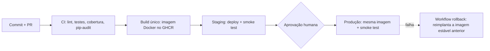

# Café com Deploy

API de cafés especiais com um pipeline de CI/CD completo: do commit à produção, com testes, containers, ambientes, banco versionado e rollback em um clique. Projeto da atividade de sistematização de **Integração e Entrega Contínuas** (pós-graduação em Engenharia DevOps, CEUB).


- **Staging:** https://cafe-staging-et1i.onrender.com
- **Produção:** https://cafe-production.onrender.com
- **Vídeo Game Day:** https://www.youtube.com/watch?v=1E6tpeISscY

## Relatório de Voo

### 1. Pipeline



Todo merge na `main` dispara o `cd.yml`, que reaproveita o `ci.yml`, constrói a imagem uma única vez, publica no GHCR com o SHA curto do commit como tag, implanta em staging, valida com smoke test, aguarda a aprovação de um revisor e promove **a mesma imagem** para produção. O rollback é um workflow manual (`rollback.yml`) que recebe o SHA curto de uma imagem estável e a reimplanta, sem novo build.

### 2. Diagnóstico: antipadrões eliminados

Humble e Farley (*Entrega Contínua*) propõem automatizar quase tudo, manter tudo sob controle de versão e antecipar a dor. A tabela mostra como cada antipadrão da Café com Deploy foi tratado.

| Antipadrão (cenário original) | Prática adotada | Evidência no repositório |
|---|---|---|
| Deploy manual via FTP, na sexta às 17h | Pipeline automatizado disparado por merge na `main`; produção só com aprovação | `.github/workflows/cd.yml` |
| Testar em ambiente parecido só no final | Staging recebe a mesma imagem que irá para produção, com smoke test antes da aprovação | Jobs `staging` e `production` do `cd.yml` |
| Configuração de ambientes feita à mão | Configuração por variáveis de ambiente (Twelve-Factor) e GitHub Environments com secrets próprios | `.env.example`, Settings → Environments |
| "Funciona na minha máquina" | Container Docker multi-stage, executado com usuário não-root, e `docker-compose` para o ambiente local | `Dockerfile`, `docker-compose.yml` |
| `ALTER TABLE` manual em produção | Migrations Alembic versionadas e aplicadas pelo container na partida | `migrations/`, `CMD` do `Dockerfile` |
| Senha do banco no código | Secrets do GitHub e do provedor; `.env` no `.gitignore`; só o `.env.example` é versionado | `.gitignore`, `.env.example` |
| Dependências "na última versão", sem controle | Versões fixadas, Dependabot semanal e `pip-audit` no CI | `requirements*.txt`, `.github/dependabot.yml`, `ci.yml` |
| Nenhum registro da versão em execução | Imagem com tag do SHA, endpoint `/version` e smoke test que confere o SHA implantado | `/version`, jobs de smoke test |
| Merge sem validação | `main` protegida por ruleset: Pull Request obrigatório e check `qualidade` verde | Settings → Rules → Rulesets |

Outras decisões de projeto:

- **Permissões mínimas nos workflows:** o `cd.yml` usa `contents: read` por padrão e libera `packages: write` apenas no job `build`. Segredos e entradas chegam aos comandos por `env:`, e não por interpolação direta de `${{ }}` no script, o que evita injeção de comandos.
- **Paridade de versão:** o CI e a imagem Docker usam a mesma versão do Python, para que o que é testado seja o que roda em produção.
- **Sem deploy desnecessário:** mudanças somente em arquivos `.md` não disparam o `cd.yml` (`paths-ignore`).
- **Dependabot tratado:** o PR #12 (atualização da imagem base do Python) foi validado pelo CI e por um deploy completo antes do merge. Atualizações de actions que o CI de Pull Request não exercita (usadas só no `cd.yml`) foram avaliadas separadamente e justificadas no próprio PR.

### 3. Estratégia de testes

A suíte segue a pirâmide de Mike Cohn: muitos testes unitários rápidos, menos testes de integração e poucos testes pós-deploy.

| Camada | Quantidade | O que cobre |
|---|---|---|
| Unitários | 7 | Regra de desconto: valores válidos, acima do máximo, negativo, limite exato e máximo configurável por variável de ambiente |
| Integração (API + banco) | 8 | Rotas `/health`, `/version`, `/cafes`, `/cafes/{id}` e `/cafes/{id}/preco`; duplicidade (409), inexistente (404), desconto inválido (422) e campo `origem` |
| Smoke / pós-deploy | 2 execuções por deploy | Consulta `/version` em staging e em produção até encontrar o SHA implantado |

- **Total:** 15 testes. Cobertura medida com `pytest --cov=app`: **93%** (mínimo exigido pelo quality gate: 70%, com `--cov-fail-under=70` no CI).
- Os testes de integração usam SQLite em memória, isolado por teste, e nunca encostam em staging ou produção.
- O CI roda em todo Pull Request e é reaproveitado pelo CD, então nada é implantado sem passar pelos mesmos testes.

### 4. Gerência de dados

O esquema evolui apenas por migrations Alembic, aplicadas automaticamente quando o container sobe (`alembic upgrade head`). Staging e produção usam bancos PostgreSQL distintos.

| # | Revisão | Descrição |
|---|---|---|
| 1 | `10724c69c80b` | Cria a tabela `cafes` |
| 2 | `20f838fe13d4` | Insere o cardápio inicial (5 cafés) com `op.bulk_insert` |
| 3 | `d929fc2b805f` | Adiciona a coluna `origem` à tabela `cafes` |

**Migration 3 e o padrão expandir e contrair.** A coluna `origem` foi criada depois do primeiro deploy em produção, como `nullable` e com valor padrão (`Não informada`). Nenhuma coluna existente foi alterada ou removida, e os cafés que já estavam em produção passaram a ter `origem` preenchida sem perda de dados (fase **expandir**). A versão anterior da aplicação, que desconhece a coluna, continua funcionando com o esquema novo, e por isso um rollback da aplicação não perde dados nem quebra. A remoção de qualquer coluna antiga só aconteceria em uma versão futura, depois de migrar os dados (fase **contrair**).

### 5. Métricas DORA

As métricas são calculadas a partir do histórico real do repositório, com o script `scripts/dora.py` (API do GitHub). Para reproduzir:

```powershell
python scripts/dora.py --desde 2026-10-15
```

**Quais execuções contam.** Os runs #1 a #13 do `cd` falharam porque os arquivos de workflow estavam vazios nos primeiros commits do projeto. Eles não executaram nenhum job e **não são deploys**, por isso ficam fora das métricas. Contam apenas as execuções que chegaram ao job `production`.

**Definições adotadas**

- **Frequência de deploy:** deploys em produção ÷ dias do período.
- **Lead time:** do primeiro commit do Pull Request até o fim do deploy em produção. O tempo de pipeline (do push na `main` até a produção) é reportado à parte.
- **Taxa de falha de mudanças:** deploys que falharam em produção ou foram revertidos ÷ total de deploys.
- **Tempo de recuperação:** do disparo do workflow `rollback` até a confirmação do smoke test. Inclui o tempo da aprovação do ambiente `production`.


**Resultado final**

python scripts/dora.py --desde 2026-10-15

## Deploys em produção

| Run cd | SHA | Primeiro commit | Fim em produção | Lead time | Pipeline | Resultado |
|---|---|---|---|---|---|---|
| #14 | `29da03f` | 15/10 22:09 | 15/10 22:38 | 28min 57s | 16min 35s | ok |
| #15 | `c6b50c3` | 15/10 22:49 | 15/10 22:51 | 1min 54s | 3min 00s | ok |
| #16 | `e55b654` | 15/10 22:22 | 15/10 22:57 | 34min 19s | 2min 59s | ok |
| #17 | `94a4a56` | 17/10 13:26 | 17/10 13:28 | 1min 35s | 3min 21s | ok |
| #18 | `6c4a793` | 17/10 13:26 | 17/10 13:43 | 16min 44s | 2min 52s | ok |
| #19 | `bfc135a` | 17/10 13:42 | 17/10 13:47 | 5min 07s | 3min 40s | ok |
| #20 | `aea1217` | 17/10 13:54 | 17/10 14:16 | 22min 41s | 17min 54s | ok |
| #21 | `cb8ae24` | 17/10 15:11 | 17/10 15:20 | 9min 14s | 3min 04s | revertido (rollback) |

## Rollbacks

| Run rollback | Início | Fim | Tempo de recuperação |
|---|---|---|---|
| #14 | 17/10 15:25 | 17/10 15:26 | 1min 02s |

## Métricas DORA

| Métrica | Valor |
|---|---|
| Frequência de deploy | 8 deploys em produção em 1.7 dias (≈ 4.7 por dia) |
| Lead time médio (primeiro commit → produção) | 15min 03s |
| Tempo médio de pipeline (push na main → produção) | 6min 40s |
| Taxa de falha de mudanças | 1/8 = 12% |
| Tempo de recuperação (rollback) | 1min 02s |

### 6. Reflexão: a Café com Deploy deveria adotar implantação contínua?

A diferença entre entrega contínua e implantação contínua está em quem decide a liberação: na primeira, todo commit aprovado gera um artefato pronto para produção e a liberação é uma decisão de negócio; na segunda, todo commit aprovado vai para produção sem intervenção humana. Hoje o projeto pratica entrega contínua, com aprovação manual no ambiente `production`.

Minha avaliação é que, **neste momento, a aprovação manual deve ser mantida**. O pipeline já reduz muito o risco: o CI barra o erro, o staging valida a mesma imagem e o rollback leva poucos minutos. Mesmo assim, a suíte cobre regras de negócio e rotas, mas não cobre o que mais machuca uma loja real, como preços e cardápio no totem. Um erro de regra de negócio que passa nos testes chegaria ao cliente sem nenhum olhar humano. A aprovação custa poucos minutos e dá um ponto de decisão sobre horário e contexto de negócio.

A implantação contínua se torna uma boa escolha quando houver: testes cobrindo os fluxos críticos; observabilidade que detecte regressão em minutos; feature flags para separar deploy de lançamento; e rollback automático quando o smoke test falhar. Com essas condições, a aprovação manual passaria a ser um gargalo no lead time, e não uma proteção. Como diz *Accelerate*, desempenho de entrega e estabilidade crescem juntos, e a evolução natural é retirar a etapa humana quando o feedback automatizado a tornar redundante.

### 7. Integrante

| Nome | Matrícula | Usuário no GitHub | Papéis exercidos |
|---|---|---|---|
| José Henrique | 82600954 | [jhenriquedsm](https://github.com/jhenriquedsm) | Release Manager, Guardião dos Testes, Engenheiro de Plataforma, DBA e Documentador |

---

## Conquistas desbloqueadas

- 📊 **Painel DORA:** `scripts/dora.py` calcula as métricas automaticamente a partir da API do GitHub (critério 8).

## Como rodar localmente

```powershell
python -m venv .venv
.venv\Scripts\Activate.ps1
pip install -r requirements.txt -r requirements-dev.txt
ruff check .
pytest --cov=app --cov-fail-under=70
```

Com Docker (API + PostgreSQL):

```powershell
docker compose up --build
curl.exe http://localhost:8000/health
```

Para aplicar as migrations fora do container, defina `DATABASE_URL` (veja `.env.example`) e rode `alembic upgrade head`. Se a porta 5432 já estiver em uso no seu computador, publique o banco em outra porta no `docker-compose.yml`.

## Estrutura

```
app/                 API FastAPI (main.py, models.py, db.py)
migrations/          migrations Alembic
tests/               testes unitários e de integração
scripts/dora.py      cálculo das métricas DORA
.github/workflows/   ci.yml, cd.yml, rollback.yml
.github/dependabot.yml
Dockerfile, docker-compose.yml, .env.example
```

## Referências

- HUMBLE, J.; FARLEY, D. *Entrega contínua*. Porto Alegre: Bookman, 2014.
- FORSGREN, N.; HUMBLE, J.; KIM, G. *Accelerate*. Portland: IT Revolution, 2018.
- WIGGINS, A. *The Twelve-Factor App*. 12factor.net/pt_br.
- DORA. *DORA's software delivery metrics*. dora.dev.